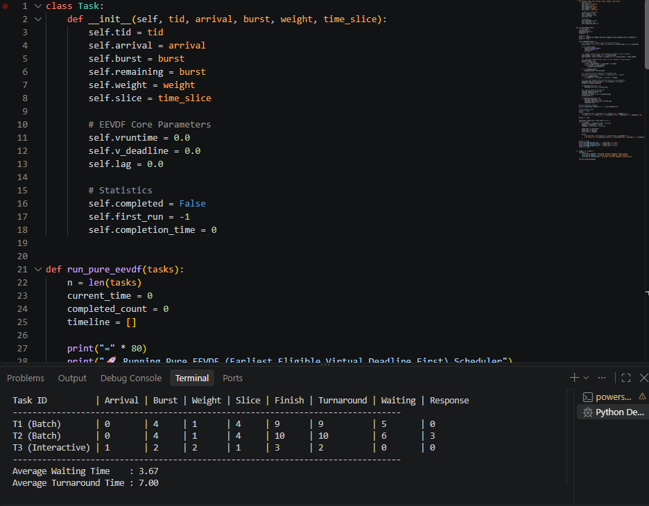

# ⚙️ EEVDF (Earliest Eligible Virtual Deadline First) - Core Algorithm

This directory contains the foundational explanation, mathematical formulation, and pure Python implementation of the **EEVDF** CPU scheduling algorithm.

## 📌 What is EEVDF?

**Earliest Eligible Virtual Deadline First (EEVDF)** is a proportional-share CPU scheduling algorithm introduced by Ion Stoica and Hussein Abdel-Wahab (1995) and merged into the **Linux Kernel (v6.6)** as the replacement for the Completely Fair Scheduler (CFS).

While CFS only focuses on equalizing `vruntime` (which often causes high latency for interactive tasks), EEVDF introduces two distinct concepts to achieve both **strict fairness** and **low latency**:

### 1. Lag & Eligibility ($Lag_i \ge 0$)
Every task $i$ has an associated weight $w_i$. **Lag** measures the difference between the CPU time a task *should* have received in an ideal fluid system and the actual service it received:
$$Lag_i(t) = S_i(t) - s_i(t)$$

* A task is **Eligible** to be scheduled if and only if its lag is non-negative ($Lag_i \ge 0$), meaning its virtual runtime (`vruntime`) is less than or equal to the system's weighted average virtual runtime ($\overline{V}$):
  $$\text{Eligible}(i) \iff vruntime_i \le \overline{V}$$

### 2. Virtual Deadline ($V_{deadline}$)
Each task requests a specific time slice (quantum) $r_i$. To prioritize latency-sensitive tasks without breaking fairness, EEVDF computes a **Virtual Deadline** for every eligible task:
$$V_{deadline}(i) = vruntime_i + \frac{r_i}{w_i}$$

* **Heavy/Batch Tasks:** Request large time slices ($r_i$), resulting in further virtual deadlines.
* **Interactive Tasks:** Request small time slices ($r_i$), receiving early virtual deadlines and immediate CPU execution.

## 🔄 Step-by-Step Execution Flow

1. **System Virtual Time Calculation:** At each scheduling decision point, the scheduler calculates the weighted average of `vruntime` across all active tasks in the runqueue.
2. **Eligibility Filtering:** Tasks with `vruntime` greater than the system average (negative lag) are temporarily filtered out because they have already consumed more than their fair share. Only tasks with `vruntime <= average` enter the eligible pool.
3. **Deadline Arbitration:** Among the eligible tasks, the scheduler calculates $V_{deadline}$ based on each task's requested quantum ($r_i$) and weight ($w_i$), granting the CPU to the task with the minimum virtual deadline.
4. **Virtual Runtime Update:** As the chosen task executes for $\Delta t$, its virtual runtime increases inversely proportional to its weight:
   $$vruntime_{new} = vruntime_{old} + \frac{\Delta t}{w_i}$$

## 📊 Sample Simulation Output

| Task ID | Arrival | Burst | Weight | Slice ($r_i$) | Finish | Turnaround | Waiting | Response |
| :--- | :---: | :---: | :---: | :---: | :---: | :---: | :---: | :---: |
| **T1 (Batch)** | 0 | 4 | 1 | 4 | 9 | 9 | 5 | 0 |
| **T2 (Batch)** | 0 | 4 | 1 | 4 | 10 | 10 | 6 | 1 |
| **T3 (Interactive)** | 1 | 2 | 2 | 1 | 4 | 3 | 1 | **0** |

* **Execution Timeline:** `T1 -> T3 -> T2 -> T3 -> T1 -> T2 -> T1 -> T2 -> T1 -> T2`
* **Average Waiting Time:** `4.00`
* **Average Turnaround Time:** `7.33`
* **Average Response Time:** `0.33`

## Execution Preview

The following screenshot shows the EEVDF simulator
during execution.



## 🚀 How to Run

```bash
python eevdf.py
