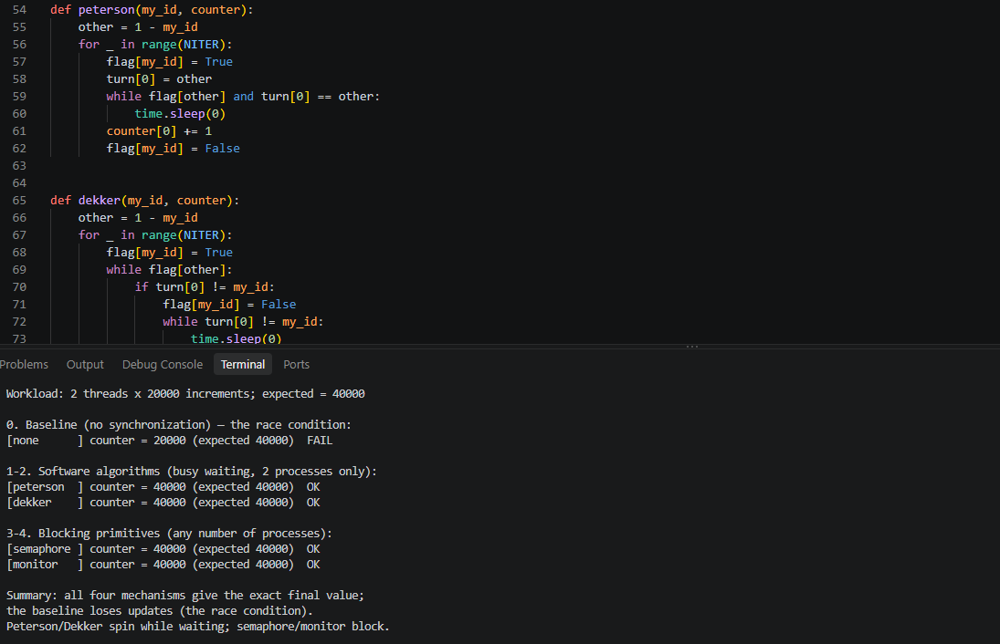

# Exercise 6 — Comparing the Monitor, Semaphore, Dekker, and Peterson Algorithms

A focused comparison of four process-synchronization mechanisms: **Peterson's algorithm** (1981), **Dekker's algorithm** (1965), **Semaphore** (Dijkstra), and **Monitor** (Brinch Hansen / Hoare). Each mechanism is presented with its pseudocode, flowchart, step-by-step trace, and a worked example, and all four are compared in one table against the same properties.

> This folder is Exercise 6 only. It does **not** cover Readers–Writers or Dining Philosophers — those are in the comprehensive synchronization study (`Process_Synchronization_Comparison_EN/FA.docx`, 57 / 56 pages).

---

## 📑 Documents (Persian & English)

| Language | File | |
|---|---|---|
| 🇬🇧 English (18 pages) | `document_english.docx` | [📖 Live preview](https://view.officeapps.live.com/op/view.aspx?src=https%3A%2F%2Fraw.githubusercontent.com%2Fkomeil1385%2FEEVDF%2Fmain%2FMonitor_Semaphore_Dekker_Peterson%2Fdocument_english.docx) · [⬇️ Download](./document_english.docx) |
| 🇮🇷 Persian / فارسی (17 pages, RTL) | `document_farsi.docx` | [📖 پیش‌نمایش آنلاین](https://view.officeapps.live.com/op/view.aspx?src=https%3A%2F%2Fraw.githubusercontent.com%2Fkomeil1385%2FEEVDF%2Fmain%2FMonitor_Semaphore_Dekker_Peterson%2Fdocument_farsi.docx) · [⬇️ دانلود](./document_farsi.docx) |

Both documents contain the same content: introduction, the race condition and the critical section, one chapter per mechanism (pseudocode, flowchart, trace), the comprehensive comparison table, executable code, sample exercises with solutions, conclusion, and references.

---

## 📊 Comparison Table

| Property | Peterson (1981) | Dekker (1965) | Semaphore | Monitor |
|---|:---:|:---:|:---:|:---:|
| **Number of processes** | Exactly 2 | Exactly 2 | Any number | Any number |
| **Flag array** | ✅ `flag[2]` | ✅ `flag[2]` | ❌ No (has the semaphore value) | ❌ No (has the monitor lock) |
| **Turn** | ✅ `turn` (0 or 1) | ✅ `turn` (0 or 1) | ❌ No | ❌ No |
| **Busy waiting** | ✅ Yes — spins in the `while` test | ✅ Yes — spins in two nested loops | ❌ No — blocks | ❌ No — blocks |
| **Temporary back-off** | ❌ No — yielding is done by writing `turn` | ✅ Yes — lower `flag`, wait for turn, raise `flag` again | ❌ No (meaningless here) | ❌ No (meaningless here) |
| **Complexity** | Low: 4 lines; short proof | Medium: back-off loop; longer proof | Low conceptually; high in correct use | Medium: monitor + condition variables |
| **Mutual exclusion** | ✅ Yes, proved (under sequentially consistent memory) | ✅ Yes, proved (under sequentially consistent memory) | ✅ Yes, with a correctly used binary semaphore | ✅ Yes, automatic |
| **Progress** | ✅ Yes | ✅ Yes | ✅ Yes, if used correctly | ✅ Yes, if used correctly |
| **Bounded waiting** | ✅ Yes, bound = 1 overtake | ✅ Yes, bound = 1 overtake | Depends on the wait-queue discipline | Depends on the queue discipline |
| **Deadlock freedom** | ✅ Yes | ✅ Yes | No guarantee — a program can deadlock | No guarantee in general |
| **Starvation freedom** | ✅ Yes | ✅ Yes | Only with a fair queue | Only with a fair queue discipline |
| **Scalability** | ❌ Exactly 2 processes | ❌ Exactly 2 processes | ✅ Any number | ✅ Any number |

**Key point:** `flag` and `turn` belong only to Peterson and Dekker. A semaphore or a monitor does not have them — writing "yes" for them in those rows would be wrong.

**In short:** Peterson is simpler than Dekker (same guarantees, shorter proof); a semaphore is the most general low-level tool but depends on programmer discipline; a monitor makes mutual exclusion automatic and is the clearest choice for shared-data problems such as a bounded buffer.

---

## 📁 Folder Contents

| File | What it is |
|---|---|
| `document_english.docx` | Full report in English (18 pages) |
| `document_farsi.docx` | Full report in Persian, RTL (17 pages) |
| `demo_code.py` | Executable Python demo — the same workload for all four mechanisms |
| `resault.png` | Screenshot of the demo running (code + terminal output) |
| `README.md` | This file |

---

## 🚀 Executable Code — `demo_code.py`

One workload for all four mechanisms: two threads each increment a shared counter 20,000 times. The correct final value is **40,000**.

```bash
python3 demo_code.py
```

No extra libraries are needed — only the Python standard library (`threading`, `time`).

### ▶️ Execution result



Text version of the same output (actually run, not invented):

```text
Workload: 2 threads x 20000 increments; expected = 40000

0. Baseline (no synchronization) — the race condition:
[none      ] counter = 20000 (expected 40000)  FAIL

1-2. Software algorithms (busy waiting, 2 processes only):
[peterson  ] counter = 40000 (expected 40000)  OK
[dekker    ] counter = 40000 (expected 40000)  OK

3-4. Blocking primitives (any number of processes):
[semaphore ] counter = 40000 (expected 40000)  OK
[monitor   ] counter = 40000 (expected 40000)  OK

Summary: all four mechanisms give the exact final value;
the baseline loses updates (the race condition).
Peterson/Dekker spin while waiting; semaphore/monitor block.
```

**Reading the result:** without synchronization the counter is **20,000, not 40,000** — exactly half of the increments are lost, because both threads load the same old value. All four mechanisms give exactly 40,000.

> ⚠️ Peterson and Dekker here are teaching demos, not production code. Their classical proofs assume atomic, sequentially-consistent reads/writes. CPython's GIL makes the plain assignments work reliably in practice here, but Python gives no memory-ordering guarantee like C11 `_Atomic`. In real programs, use `threading.Lock` / `threading.Semaphore` (as in experiments 3–4).

---

## 📚 References

- A. Silberschatz, P. B. Galvin, and G. Gagne, *Operating System Concepts*, 10th ed., Wiley, 2018, chs. 6–7.
- G. L. Peterson, "Myths about the mutual exclusion problem", *Information Processing Letters*, vol. 12, no. 3, pp. 115–116, 1981.
- Th. J. Dekker, reported in E. W. Dijkstra, "Cooperating sequential processes", 1968; original solution 1965.
- E. W. Dijkstra, "Cooperating sequential processes", 1965 — introduction of the semaphore.
- P. Brinch Hansen, *Operating System Principles*, Prentice-Hall, 1973; C. A. R. Hoare, "Monitors: an operating system structuring concept", *Communications of the ACM*, vol. 17, no. 10, pp. 549–557, 1974.
- E. Barati (THE-ERPHUN), "Synchronization Mechanisms Comparison", <https://github.com/THE-ERPHUN/synchronization-mechanisms-comparison> — reference project for the comparison style.
