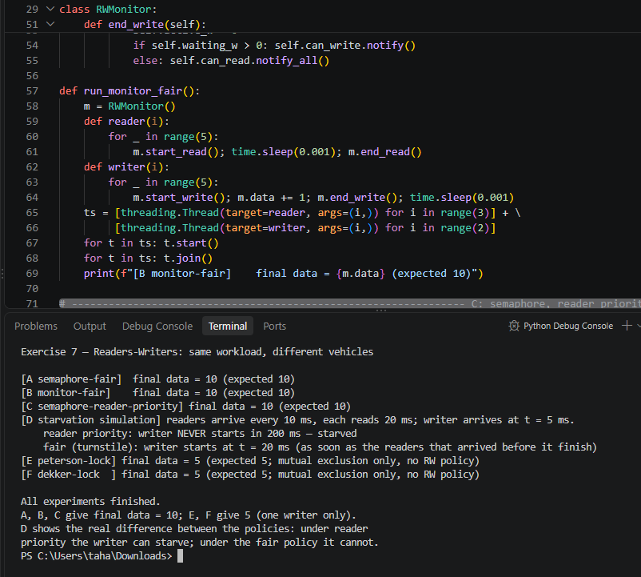

# Comparing Readers–Writers with Semaphore, Monitor, Dekker, and Peterson

A full comparison of the **readers–writers problem** against four synchronization mechanisms: **Semaphore** (Dijkstra), **Monitor** (Brinch Hansen / Hoare), **Peterson's algorithm** (1981), and **Dekker's algorithm** (1965). Each mechanism is presented with its pseudocode, flowchart, step-by-step trace, and a worked example, and all five are compared in one table against the same properties.


---

## 📑 Documents (Persian & English)

| Language | File | |
|---|---|---|
| 🇬🇧 English (43 pages) | `document_english.docx` | [📖 Live preview](https://view.officeapps.live.com/op/view.aspx?src=https%3A%2F%2Fraw.githubusercontent.com%2Fkomeil1385%2FEEVDF%2Fmain%2FReaders_Writers_Comparison%2Fdocument_english.docx) · [⬇️ Download](./document_english.docx) |
| 🇮🇷 Persian / فارسی (41 pages, RTL) | `document_farsi.docx` | [📖 پیش‌نمایش آنلاین](https://view.officeapps.live.com/op/view.aspx?src=https%3A%2F%2Fraw.githubusercontent.com%2Fkomeil1385%2FEEVDF%2Fmain%2FReaders_Writers_Comparison%2Fdocument_farsi.docx) · [⬇️ دانلود](./document_farsi.docx) |

Both documents contain the same content: the readers–writers problem definition and database state diagram, one chapter per mechanism (pseudocode, flowchart, trace), the three policies (reader priority, writer priority, fair), the comprehensive comparison table, executable code with real output, worked examples, six exercises with full solutions, practical applications, common errors, and appendices (C/POSIX implementation, quiz, submission checklist, complete fair-policy trace, one-page revision, study plan).

> ⚠️ **File names:** the documents delivered for this exercise are named `Readers_Writers_Comparison_Exercise7_FULL_FA.docx` (41 pp.) and `Readers_Writers_Comparison_Exercise7_FULL_EN.docx` (43 pp.). Before uploading, rename them to `document_farsi.docx` and `document_english.docx` — the names used in the links above — exactly as was done for Exercise 6.

---

## 📊 Comparison Table

| Property | Readers–Writers (problem) | Semaphore (vehicle) | Monitor (vehicle) | Peterson | Dekker |
|---|:---:|:---:|:---:|:---:|:---:|
| **Kind** | Coordination problem | General OS mechanism | Language mechanism | Complete algorithm, 2 processes | Complete algorithm, 2 processes |
| **Number of processes** | Any | Any | Any | Exactly 2 | Exactly 2 |
| **Mutual exclusion** | Yes, in every policy (writers are exclusive) | Yes, with a correctly used binary semaphore | Yes, automatic | Yes, proved (under sequentially consistent memory) | Yes, proved (under sequentially consistent memory) |
| **Progress** | Yes, in every policy | Yes, if used correctly | Yes, if used correctly | Yes | Yes |
| **Bounded waiting** | Reader priority: No for writers; fair policy: Yes for both | Not by itself; depends on queue discipline | Not by itself; depends on queue discipline | Yes, bound = 1 overtake | Yes, bound = 1 overtake |
| **Deadlock freedom** | Yes, under the standard policies | No guarantee — a program can deadlock | No guarantee in general; a correct single monitor is free | Yes | Yes |
| **Starvation freedom** | Reader priority: a writer can starve; fair: neither side | Only with a fair (FIFO) queue; POSIX does not guarantee it | Only with a fair queue discipline | Yes (follows from bounded waiting) | Yes |
| **Busy waiting** | No, if built on blocking semaphores / monitors | No — blocks | No — blocks | Yes — spins in the `while` test | Yes — spins in two nested loops |
| **Simultaneous reading** | ✅ Yes — the heart of the problem | ✅ Yes, with the readCount counter | ✅ Yes, with the activeReaders counter | ❌ No; mutual exclusion only | ❌ No; mutual exclusion only |
| **Policy (priority)** | The problem itself: reader / writer / fair | Must be built explicitly (gate, …) | Chosen by the startRead / startWrite conditions | None; only turn | None; only turn |
| **Complexity** | Medium; one counter + two semaphores | Low conceptually; high in correct use | Medium; the compiler helps | Low; 4 lines, short proof | Medium; back-off loop, longer proof |
| **Implementation requirements** | A semaphore or a monitor | Atomic wait / signal + wait queues | Language support for a lock + condition variables | Shared memory + atomic, sequentially consistent access | Same as Peterson |
| **Main limitation** | No single best policy | Easy to misuse; a forgotten signal deadlocks | No native support in C; a signal with no waiter is lost | 2 processes; busy waiting; depends on the memory model | Same as Peterson, plus a fragile back-off |

**Key point:** Peterson and Dekker have no notion of "readers" at all — they serialize *everyone*. That is why their **Simultaneous reading** row is ❌, while the semaphore and monitor rows are ✅.

### Peterson vs Dekker (for readers–writers: only as a lock, for 2 processes)

| Aspect | Peterson (1981) | Dekker (1965) |
|---|---|---|
| Shared variables | `flag[2]`, `turn` | `flag[2]`, `turn` (identical) |
| Entry test | Single `while`: `flag[j]` and `turn == j` | Outer `while` on `flag[j]` + inner `while` on `turn`, with back-off |
| Back-off | Not needed | Explicit: lower `flag`, wait for turn, raise `flag` again |
| Which is better? | Simpler, shorter proof; use Peterson for new explanations | The first historical solution; its importance is historical |

### Semaphore vs Monitor (the two real vehicles)

| Aspect | Semaphore | Monitor |
|---|---|---|
| Mutual exclusion | The programmer's job: pair wait / signal | Automatic: one procedure at a time |
| Reader / writer waiting | Wait on a semaphore (`wrt` or the gate) | Wait on a condition variable (`canRead` / `canWrite`) |
| Signal | Remembered (the counter is incremented) | Lost if nobody is waiting |
| Typical bug | Forgotten signal → deadlock | `if` instead of `while` after wait → lost condition |
| Reading the policy from the code | Hard; the policy hides in the order of waits | Clear; the policy is written in the `startRead` / `startWrite` conditions |
| Support in Python | `threading.Semaphore` | Not native; built from `Lock` + `Condition` |

### One scenario, two policies — why fairness matters

Readers R1, R2, then writer W1, then reader R3:

| Time | Event | Reader priority | Fair policy (gate) |
|---|---|---|---|
| t0 | R1 and R2 start reading | Reading | Reading |
| t1 | W1 arrives and waits | Waits | Waits (holds the gate) |
| t2 | R3 arrives | Reads (overtakes W1) | Queues behind W1 |
| t3–t4 | R1, R2, R3 finish | W1 still waits, then finally writes | W1 writes |
| t5 | W1 finishes | Later readers read | Later readers read |

Under reader priority, a steady stream of new readers can starve the writer forever. The fair policy (a gate / turnstile) closes the door behind a waiting writer, so no new reader can overtake it.

---

## 📁 Folder Contents

| File | What it is |
|---|---|
| `document_english.docx` | Full report in English (43 pages) |
| `document_farsi.docx` | Full report in Persian, RTL (41 pages) |
| `demo_code.py` | Executable Python demo — six experiments, one workload |
| `resault.png` | Screenshot of the demo running (code + terminal output) |
| `README.md` | This file |

> ⚠️ **Before uploading:** rename the delivered files to these names — `Readers_Writers_Comparison_Exercise7_FULL_EN.docx` → `document_english.docx`, `Readers_Writers_Comparison_Exercise7_FULL_FA.docx` → `document_farsi.docx`, `rw_ex7_demo.py` → `demo_code.py` — and add a screenshot of the demo running as `resault.png` (run `python3 demo_code.py`, screenshot the terminal, save it with exactly that name). Until `resault.png` is uploaded, the image below will not display.

---

## 🚀 Executable Code — `demo_code.py`

Six experiments on the same workload: **3 readers and 2 writers, 5 rounds each** (final value 10 = 2 writers × 5 writes), plus a deterministic starvation simulation and the Peterson/Dekker lock experiments.

```bash
python3 demo_code.py
```

No extra libraries are needed — only the Python standard library (`threading`, `time`).

### ▶️ Execution result



Text version of the same output (actually run three times, identical results):

```text
Exercise 7 — Readers-Writers: same workload, different vehicles

[A semaphore-fair]  final data = 10 (expected 10)
[B monitor-fair]    final data = 10 (expected 10)
[C semaphore-reader-priority] final data = 10 (expected 10)
[D starvation simulation] readers arrive every 10 ms, each reads 20 ms; writer arrives at t = 5 ms.
    reader priority: writer NEVER starts in 200 ms — starved
    fair (turnstile): writer starts at t = 20 ms (as soon as the readers that arrived before it finish)
[E peterson-lock] final data = 5 (expected 5; mutual exclusion only, no RW policy)
[F dekker-lock  ] final data = 5 (expected 5; mutual exclusion only, no RW policy)

All experiments finished.
A, B, C give final data = 10; E, F give 5 (one writer only).
D shows the real difference between the policies: under reader
priority the writer can starve; under the fair policy it cannot.
```

**Reading the result:** experiments A, B, and C all give the correct final value — so the final value alone does not distinguish the policies. Experiment D is the decisive one: with readers arriving every 10 ms and each reading for 20 ms, at least one reader is always active, so under reader priority the writer **never** starts in 200 ms, while under the fair policy it writes at t = 20 ms. Experiments E and F show that Peterson and Dekker give only mutual exclusion (final data = 5, one writer only) — no readers–writers policy at all.

> ⚠️ Peterson and Dekker here are teaching demos, not production code. Their classical proofs assume atomic, sequentially-consistent reads/writes. CPython's GIL makes the plain assignments work reliably in practice here, but Python gives no memory-ordering guarantee like C11 `_Atomic`. In real programs, use `threading.Lock` / `threading.Semaphore` (as in experiments A–C).

---

## 📚 References

- A. Silberschatz, P. B. Galvin, and G. Gagne, *Operating System Concepts*, 10th ed., Wiley, 2018, chs. 6–7.
- P. J. Courtois, F. Heymans, and D. L. Parnas, "Concurrent control with ‘readers’ and ‘writers’", *Communications of the ACM*, vol. 14, no. 10, pp. 667–668, 1971.
- G. L. Peterson, "Myths about the mutual exclusion problem", *Information Processing Letters*, vol. 12, no. 3, pp. 115–116, 1981.
- Th. J. Dekker, reported in E. W. Dijkstra, "Cooperating sequential processes", 1968; original solution 1965.
- E. W. Dijkstra, "Cooperating sequential processes", 1965 — introduction of the semaphore.
- P. Brinch Hansen, *Operating System Principles*, Prentice-Hall, 1973; C. A. R. Hoare, "Monitors: an operating system structuring concept", *Communications of the ACM*, vol. 17, no. 10, pp. 549–557, 1974.
- E. Barati (THE-ERPHUN), "Synchronization Mechanisms Comparison", <https://github.com/THE-ERPHUN/synchronization-mechanisms-comparison> — reference project for the comparison style.
